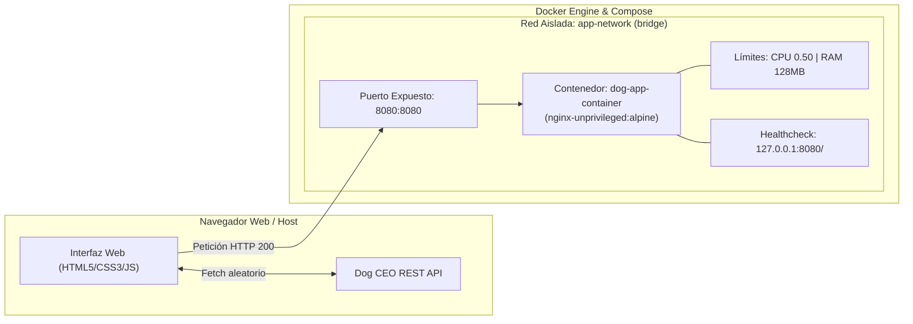
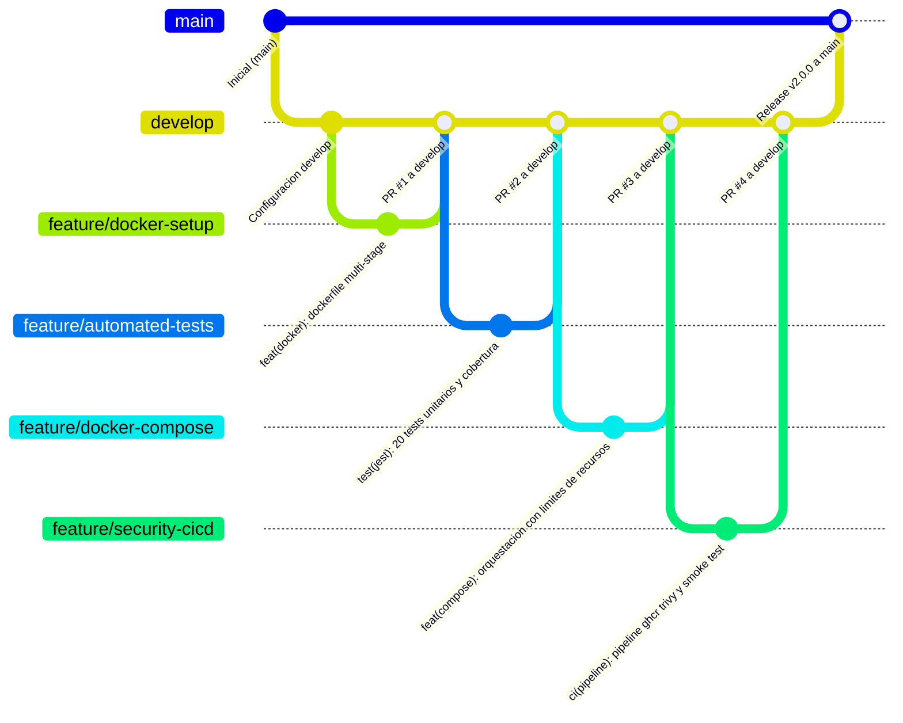

# Lista de perros 🐶 - DevOps Engineering Platform

**Asignatura:** Ingeniería DevOps (DOY0101)  
**Evaluación:** Evaluación Parcial 2 (Auditoría, Corrección y Validación Continua)  
**Repositorio Oficial:** [https://github.com/Shiroasd/evaluacion-devops-002D](https://github.com/Shiroasd/evaluacion-devops-002D)  
**Rama Principal:** `main` (Producción) | **Rama de Integración:** `develop` (Staging)

---

## 📋 Descripción del Proyecto y Objetivo de la Evaluación

**Lista de perros** es una aplicación web interactiva que consume la API REST pública de [dog.ceo](https://dog.ceo/dog-api/) para clasificar imágenes caninas en preferencias de usuario (*"Me gusta"* / *"No me gusta"* / *"Saltear"*), manteniendo un registro reactivo de contadores y galerías dinámicas en el DOM.

### Objetivo de la Evaluación DevOps
El objetivo de este proyecto es transformar una aplicación web estática inicial en una plataforma con estándares profesionales de Ingeniería DevOps, resolviendo las observaciones de la retroalimentación docente mediante el cumplimiento estricto y comprobable de los cinco indicadores de evaluación:
1. **IE1. Uso de Contenedores:** Empaquetado en contenedor Docker multi-stage ultraligero (~25 MB), ejecutado bajo usuario sin privilegios (`non-root`, UID 101), con directiva `HEALTHCHECK` funcional y parches de seguridad aplicados.
2. **IE2. Pruebas Automatizadas en Pipelines CI:** Suite de pruebas unitarias con **Jest** y entorno **JSDOM** que cubren la lógica de negocio y manipulación de interfaz, aplicando un umbral estricto de cobertura (`coverageThreshold` >= 75%) que bloquea el pipeline ante cualquier degradación.
3. **IE3. Parámetros de Escalabilidad y Seguridad:** Gobernanza de seguridad *Shift-Left*: principio de menor privilegio en tokens de GitHub Actions, escaneo continuo con **Dependabot** (npm, github-actions, docker), auditoría estricta de dependencias con `npm audit`, escaneo de vulnerabilidades en imágenes con **Trivy** (bloqueante en HIGH/CRITICAL) y delimitación de recursos de CPU y RAM.
4. **IE4. Despliegue Automático y Trazabilidad:** Integración continua que genera artefactos inmutables en **GitHub Container Registry (GHCR)** con trazabilidad criptográfica por commit SHA completo, despliegue simulado en runner efímero y prueba de humo (*Smoke Test*) con validación de código HTTP 200 y comprobación de contenido HTML legítimo.
5. **IE5. Orquestación de Contenedores:** Orquestación reproducible mediante **Docker Compose**, configuración de servicios, red bridge aislada, política de reinicio `unless-stopped`, healthcheck sincronizado y límites duros de memoria y cómputo.

---

## 🛠️ Tecnologías Utilizadas

- **Frontend Core:** HTML5 semántico, CSS3 Vanilla (variables CSS, flexbox, glassmorphism y micro-animaciones), JavaScript Vanilla (ES6+ modular).
- **Entorno de Ejecución:** Node.js v20 LTS / v24.
- **Testing & Calidad:** Jest v29, `jest-environment-jsdom`, ESLint v8.57.0 (análisis estático léxico y sintáctico).
- **Contenedorización:** Docker v29+, Multi-stage build (`node:20-alpine` builder + `nginxinc/nginx-unprivileged:alpine` runtime).
- **Orquestación:** Docker Compose v2.x / v5.x.
- **Seguridad & Análisis:** Aqua Security Trivy, npm audit, GitHub Dependabot, OCI Metadata Labels.
- **CI/CD & Registro:** GitHub Actions, GitHub Container Registry (`ghcr.io`).

---

## 🏛️ Arquitectura General del Sistema



---

## 📁 Estructura del Repositorio

```text
evaluacion-devops-002D/
├── .github/
│   ├── dependabot.yml          # Configuración de Dependabot (npm, github-actions, docker)
│   └── workflows/
│       └── ci-cd.yml           # Pipeline CI/CD (Calidad, Trivy, GHCR, Despliegue, Smoke Test)
├── tests/
│   └── app.test.js             # Suite de 20 pruebas unitarias Jest con JSDOM
├── .dockerignore               # Exclusión estricta de archivos temporales y secretos del build
├── .gitignore                  # Exclusión para control de versiones Git
├── Dockerfile                  # Multi-stage build con Nginx Alpine non-root, OCI labels y healthcheck
├── docker-compose.yml          # Orquestación con red bridge, límites de CPU/RAM y healthcheck
├── index.html                  # Marcado semántico, panel de contadores y contenedor de errores
├── index.js                    # Lógica modular: llamadas API, contadores inmutables, eventos DOM
├── package.json                # Metadatos del proyecto, scripts (test, test:coverage, lint) y coverageThreshold
├── package-lock.json           # Fijación determinista de árbol de dependencias
├── style.css                   # Sistema visual, diseño responsivo, loaders y badges
└── README.md                   # Documentación técnica integral de DevOps y evidencia
```

---

## 🚀 Guía de Instalación y Ejecución

### Requisitos Previos
- **Docker Desktop** (v24 o superior) con Docker Compose habilitado.
- **Node.js** (v20 LTS o superior) y **npm** (v10 o superior) para desarrollo local de pruebas.
- Cliente de línea de comandos (`curl` o navegador moderno).

---

### Opción 1: Ejecución con Docker Compose (Recomendada para Producción/Evaluación)

Esta opción recrea el entorno idéntico al runner de despliegue:

```bash
# 1. Validar la sintaxis del archivo de orquestación
docker compose config

# 2. Construir la imagen y levantar el servicio en segundo plano
docker compose up -d --build

# 3. Monitorear el estado de salud del contenedor (debe alcanzar estado healthy)
docker compose ps

# 4. Inspeccionar los registros del servicio Nginx
docker compose logs

# 5. Realizar una petición de comprobación (Smoke Test local)
curl.exe -i http://localhost:8080/

# 6. Detener el servicio y eliminar contenedores y redes asociadas
docker compose down
```

La aplicación se encontrará disponible en: `http://localhost:8080/`.

---

### Opción 2: Desarrollo Local y Suite de Calidad de Código

Para ejecutar la verificación estática y suite de pruebas en el entorno de desarrollo:

```bash
# 1. Instalar dependencias fijadas de manera reproducible
npm ci

# 2. Validar sintaxis nativa de JavaScript con el motor V8
node --check index.js

# 3. Ejecutar análisis estático con ESLint
npm run lint

# 4. Ejecutar auditoría de seguridad de dependencias
npm audit --audit-level=high

# 5. Ejecutar la suite completa de pruebas unitarias
npm test

# 6. Ejecutar pruebas con reporte detallado y validación de cobertura mínima
npm run test:coverage
```

---

## 🧪 Pruebas Automatizadas y Métricas de Cobertura (IE2)

La suite de pruebas en [tests/app.test.js](./tests/app.test.js) implementa **20 casos de prueba independientes** utilizando Jest y JSDOM para aislar completamente las dependencias externas (API Dog CEO) mediante *mocks* y simular la interacción del navegador.

### Distribución de Módulos de Prueba
- **Módulo 1: Validación de Recursos Multimedia (`validarUrlImagen`):**
  - Validación de extensiones permitidas (`.jpg`, `.jpeg`, `.png`, `.webp`, `.gif`) y mayúsculas (`.JPG`).
  - Rechazo de extensiones incompatibles (`.pdf`, `.html`, endpoints sin extensión).
  - Rechazo de entradas inválidas: cadenas vacías, espacios en blanco, valores `null`, `undefined` y tipos numéricos.
- **Módulo 2: Lógica de Negocio y Contadores (`actualizarContador`, `registrarInteraccion`):**
  - Incremento aritmético seguro partiendo de valores numéricos o texto convertible.
  - Manejo de valores corruptos, negativos o no numéricos retornando valor mínimo seguro.
  - Aplicación de valores por defecto si se invocan funciones sin argumentos.
  - Actualización inmutable del objeto de estado para interacciones `+`, `-`, `like`, `dislike` y preservación ante tipos no reconocidos.
- **Módulo 3: Resiliencia de Red y Consumo de API (`obtenerPerroAleatorio`, `manejarErrorRed`):**
  - Procesamiento correcto de respuestas exitosas HTTP 200 con formato JSON válido de Dog CEO.
  - Captura controlada de códigos de error de servidor (HTTP 500, HTTP 404).
  - Modelado estructurado ante rechazos de promesa (excepciones de conexión o caída de red).
  - Manejo de respuestas con estructura inesperada o URLs maliciosas.
  - Rechazo controlado cuando el cliente HTTP no está disponible.
- **Módulo 4: Manipulación del DOM y Experiencia de Usuario (`rankearPerro`, `nuevoPerro`, `inicializarApp`):**
  - Inserción de imágenes en las galerías correspondientes y actualización del texto de contadores en el DOM.
  - Compatibilidad total con argumentos estándar y alias textuales (`like`, `dislike`).
  - Activación de indicadores de carga (*spinner*) y ocultamiento condicional de la imagen previa.
  - Visualización del banner de error visual cuando la API externa no responde.
  - Vinculación reactiva de eventos `click` en botones y evento `load` de imágenes.
  - Resiliencia y ejecución segura ante árboles del DOM vacíos o elementos inexistentes.

### Umbral Estricto de Cobertura (`coverageThreshold`)
Configurado en [package.json](./package.json), el pipeline exige un mínimo del **75%** en las cuatro dimensiones fundamentales:

| Dimensión de Cobertura | Umbral Exigido | Porcentaje Real Obtenido | Estado |
| :--- | :---: | :---: | :---: |
| **Statements (Sentencias)** | 75% | **97.22%** | ✅ Aprobado |
| **Branches (Ramas de decisión)** | 75% | **82.14%** | ✅ Aprobado |
| **Functions (Funciones)** | 75% | **100.00%** | ✅ Aprobado |
| **Lines (Líneas de código)** | 75% | **98.94%** | ✅ Aprobado |

*Resultado:* **20/20 pruebas aprobadas (100%)**. Si cualquiera de las métricas cae por debajo del 75%, el comando finaliza con código de error, interrumpiendo automáticamente el pipeline.

---

## 🐳 Contenedorización y Orquestación (IE1, IE5)

### Dockerfile Multi-Stage ([Dockerfile](./Dockerfile))
1. **Stage 1 (`builder` - `node:20-alpine`):**
   - Valida la integridad sintáctica de `index.js` mediante el motor V8 (`node --check index.js`) antes del empaquetado final.
2. **Stage 2 (`runtime` - `nginxinc/nginx-unprivileged:alpine`):**
   - **Base Segura:** Imagen oficial sin privilegios basada en Alpine Linux.
   - **Parches del Sistema Operativo:** Capa `apk update && apk upgrade --no-cache` que actualiza librerías críticas (`brotli-libs`, `curl`, `libcurl`, `musl`), eliminando vulnerabilidades conocidas.
   - **Principio de Menor Privilegio (Non-Root):** Ejecución asignada al usuario `nginx` (UID 101). No se ejecutan procesos como superusuario en runtime.
   - **Puerto No Privilegiado:** Nginx configurado para escuchar en el puerto `8080` (compatible con usuarios non-root sin capabilities especiales de kernel).
   - **Healthcheck Funcional:**
     ```dockerfile
     HEALTHCHECK --interval=30s --timeout=3s --retries=3 --start-period=5s \
       CMD wget -q -O /dev/null http://127.0.0.1:8080/ || exit 1
     ```
     Utiliza la dirección loopback IPv4 (`127.0.0.1:8080`) para evitar fallos de resolución en entornos Alpine con pila dual IPv6/IPv4.
   - **Tamaño de Imagen:** ~25.9 Megabytes (ultraligera).

### Docker Compose ([docker-compose.yml](./docker-compose.yml))
Define la infraestructura declarativa de despliegue:
- **Servicio:** `web-service` con nombre de contenedor estandarizado `dog-app-container`.
- **Mapeo de Red:** Puerto host `8080` vinculado al puerto de contenedor `8080`.
- **Red Aislada:** Red bridge dedicada `app-network`.
- **Política de Reinicio:** `restart: unless-stopped`.
- **Límites de Recursos:**
  - `limits.cpus: "0.50"` (máximo 50% de un núcleo de CPU).
  - `limits.memory: 128M` (techo de memoria RAM de 128 MB).
  - `reservations.cpus: "0.10"`, `reservations.memory: 64M`.
- **Sincronización de Salud:** Intervalo de 15s con 3 reintentos para detección ágil de degradación.

---

## 🛡️ Seguridad, Gobernanza y Escalabilidad (IE3)

1. **Principio de Mínimo Privilegio en GitHub Actions:**
   - Permisos globales del workflow restringidos a solo lectura:
     ```yaml
     permissions:
       contents: read
     ```
   - El permiso `packages: write` se concede **exclusivamente al job de publicación** (`build-security-and-publish`), evitando la exposición de privilegios en jobs de pruebas o despliegue.
2. **Dependabot ([.github/dependabot.yml](./.github/dependabot.yml)):**
   - Monitoreo semanal (lunes a las 04:00 AM) para tres ecosistemas críticos:
     - `npm`: Dependencias del proyecto.
     - `github-actions`: Acciones versionadas del workflow.
     - `docker`: Imágenes base (`node:20-alpine` y `nginxinc/nginx-unprivileged:alpine`).
3. **Auditoría de Dependencias (`npm audit`):**
   - Configurado con nivel `--audit-level=high` para prevenir la introducción de dependencias vulnerables en producción.
4. **Escaneo de Vulnerabilidades con Trivy:**
   - La acción `aquasecurity/trivy-action@v0.36.0` inspecciona la imagen construida antes de autorizar su publicación.
   - Parámetros bloqueantes: `exit-code: '1'`, `severity: 'CRITICAL,HIGH'`, `ignore-unfixed: true`.
   - **Resultado de la Auditoría:** **0 vulnerabilidades HIGH/CRITICAL** tras la incorporación de los parches en el Dockerfile.

---

## 🔄 Pipeline CI/CD, Despliegue y Trazabilidad (IE4)

El pipeline automatizado en [.github/workflows/ci-cd.yml](./.github/workflows/ci-cd.yml) coordina tres fases consecutivas con Quality Gates bloqueantes:

```mermaid
flowchart TD
    Trigger([Push o PR a main / develop]) --> Job1[Job 1: Calidad de Código y Pruebas Unitarias]
    
    subgraph Job1_Details ["Fase 1: Calidad (IE2)"]
        J1A[Checkout Repository] --> J1B[Setup Node.js v20]
        J1B --> J1C[Verificar Integridad de Archivos]
        J1C --> J1D[Validar Sintaxis: node --check index.js]
        J1D --> J1E[npm ci]
        J1E --> J1F[ESLint: npm run lint]
        J1F --> J1G[Auditoría: npm audit --audit-level=high]
        J1G --> J1H[Pruebas Unitarias + Cobertura: npm run test:coverage]
    end
    
    Job1 -->|Exitoso| Job2[Job 2: Build Docker, Trivy y Publicación GHCR]
    
    subgraph Job2_Details ["Fase 2: Seguridad y GHCR (IE1, IE3, IE4)"]
        J2A[Docker Buildx: Construir Imagen + Inyectar COMMIT_SHA] --> J2B[Escaneo Trivy: CRITICAL,HIGH con exit-code 1]
        J2B --> J2C{¿Evento Push?}
        J2C -- Sí --> J2D[Publicar en GHCR: sha-commit]
        J2D --> J2E{¿Rama main?}
        J2E -- Sí --> J2F[Publicar tag latest]
        J2E -- No develop --> J2G[Publicar tag develop]
        J2C -- PR --> J2H[Omitir Publicación]
    end
    
    Job2 -->|Exitoso| Job3[Job 3: Despliegue en Entorno Simulado y Smoke Test]
    
    subgraph Job3_Details ["Fase 3: Despliegue y Smoke Test (IE4, IE5)"]
        J3A[docker compose up -d --build] --> J3B[Monitoreo de Healthcheck: Bucle de 30 intentos]
        J3B --> J3C{¿Contenedor healthy?}
        J3C -- No timeout --> J3_Fail[Fallo Crítico: exit 1 + logs]
        J3C -- Sí --> J3D[Smoke Test HTTP: curl localhost:8080/]
        J3D --> J3E{¿HTTP 200 y Contenido Valido?}
        J3E -- No --> J3_Fail
        J3E -- Sí --> J3F[Teardown: docker compose down -v]
    end
```



### Cadena de Trazabilidad Inmutable
1. **Commit Git:** Cada cambio genera un hash criptográfico único (ej. `3f9a7b2...`).
2. **Metadatos OCI:** El commit SHA se inyecta como argumento de build (`ARG COMMIT_SHA`) y queda plasmado en la etiqueta `org.opencontainers.image.revision` de la imagen.
3. **Publicación en GHCR:** La imagen se etiqueta unívocamente como `ghcr.io/shiroasd/evaluacion-devops-002d:<full-sha>`.
4. **Política de Tags:**
   - La etiqueta `:latest` se reserva **exclusivamente para despliegues originados en la rama `main`**.
   - Los pushes a `develop` generan la etiqueta `:develop` y el hash SHA correspondiente, evitando colisiones accidentales con el artefacto de producción.
5. **Smoke Test con Verificación de Contenido:**
   - El script no solo verifica que el código de respuesta HTTP sea `200 OK`, sino que analiza el cuerpo de la respuesta mediante `grep` para certificar la presencia del texto esperado (`¿Te gusta este perro?`), asegurando que no se esté sirviendo una página de error o un recurso por defecto.

---

## 🌳 Estrategia de Ramificación (GitFlow)

El equipo aplica **GitFlow** para desacoplar el ciclo de desarrollo de las versiones productivas:

- `main`: Rama de producción. Solo recibe código validado mediante Pull Request aprobado.
- `develop`: Rama de integración continua (Staging). Consolida features antes de liberar versiones.
- `feature/*`: Ramas de características individuales que nacen de `develop` y retornan a `develop` mediante Pull Request.
- `hotfix/*`: Parches urgentes ante incidentes de producción que nacen de `main` y se fusionan a `main` y `develop`.



---

## 📊 Matriz de Cumplimiento de Indicadores de Evaluación

| Indicador | Puntos | Estado | Evidencia Técnica Comprobable |
| :--- | :---: | :---: | :--- |
| **IE1. Uso de contenedores** | 20 / 20 | **CUMPLIDO** | [Dockerfile](./Dockerfile) multi-stage (`node:20-alpine` + `nginxinc/nginx-unprivileged:alpine`). Imagen de 25.9 MB, usuario `nginx` (UID 101), puerto no privilegiado 8080, directiva `HEALTHCHECK` con loopback IPv4 (`127.0.0.1:8080`) y parches de seguridad de SO aplicados. |
| **IE2. Pruebas automatizadas en pipelines CI** | 20 / 20 | **CUMPLIDO** | Suite de 20 pruebas en [tests/app.test.js](./tests/app.test.js) con Jest y JSDOM. Cobertura real: **97.22% Statements**, **82.14% Branches**, **100% Functions**, **98.94% Lines** (umbral exigido >= 75%). Scripts `npm test`, `npm run test:coverage` y `npm run lint`. Quality Gate bloqueante en CI. |
| **IE3. Parámetros de escalabilidad y seguridad** | 20 / 20 | **CUMPLIDO** | Principio de menor privilegio en GitHub Actions (`contents: read` global, `packages: write` aislado al job de publicación). [.github/dependabot.yml](./.github/dependabot.yml) con escaneo semanal para npm, github-actions y docker. `npm audit --audit-level=high`. Escaneo Trivy sin vulnerabilidades HIGH/CRITICAL. Límites en Docker Compose: CPU 0.50, RAM 128 MB. |
| **IE4. Despliegue automático y trazabilidad** | 20 / 20 | **CUMPLIDO** | Pipeline en [.github/workflows/ci-cd.yml](./.github/workflows/ci-cd.yml). Publicación automatizada en GHCR etiquetada con commit SHA completo y metadatos OCI (`ARG COMMIT_SHA`). Tag `latest` reservado solo para `main`. Despliegue simulado con Docker Compose. Smoke Test con validación de código HTTP 200 y verificación de contenido HTML legítimo. Teardown automático. |
| **IE5. Orquestación de contenedores** | 20 / 20 | **CUMPLIDO** | [docker-compose.yml](./docker-compose.yml) con sintaxis validada (`docker compose config`). Servicio `web-service`, contenedor `dog-app-container`, red bridge dedicada `app-network`, política `restart: unless-stopped`, healthcheck funcional de 15s y límites estrictos de CPU y memoria. Validación comprobada localmente con `up -d`, `ps`, `logs` y `down`. |

---

## 👥 Autores y Gobernanza DevOps

- **Integrante 1:** Gaspar Toro
- **Integrante 2:** Alvaro Pérez

---

### Reflexión Individual - Gaspar Toro
El desarrollo y corrección de esta fase consolidó la importancia del enfoque *Shift-Left Security* y la automatización rigurosa dentro del ciclo de vida del software. Implementar un contenedor con usuario sin privilegios (`non-root`) y someterlo a un escaneo estricto con Trivy con código de salida bloqueante evidenció cómo las políticas de seguridad dejan de ser un paso manual al final del desarrollo para convertirse en puertas de calidad (*Quality Gates*) automáticas. La trazabilidad lograda mediante el etiquetado por commit SHA en GHCR y el despliegue simulado con smoke test garantizan que cada artefacto liberado sea inmutable, seguro y completamente reproducible.

---

### Reflexión Individual - Alvaro Pérez
La integración de pruebas unitarias con Jest bajo un umbral de cobertura estricto (`coverageThreshold`) representó un salto de calidad fundamental respecto a etapas anteriores. Ya no solo validamos la sintaxis del código, sino que garantizamos la integridad funcional de la lógica de negocio y el manejo resiliente de errores ante caídas de la API. Asimismo, la orquestación con Docker Compose delimitando recursos de CPU y memoria demostró cómo la infraestructura como código previene riesgos operativos de sobreconsumo en entornos productivos.
