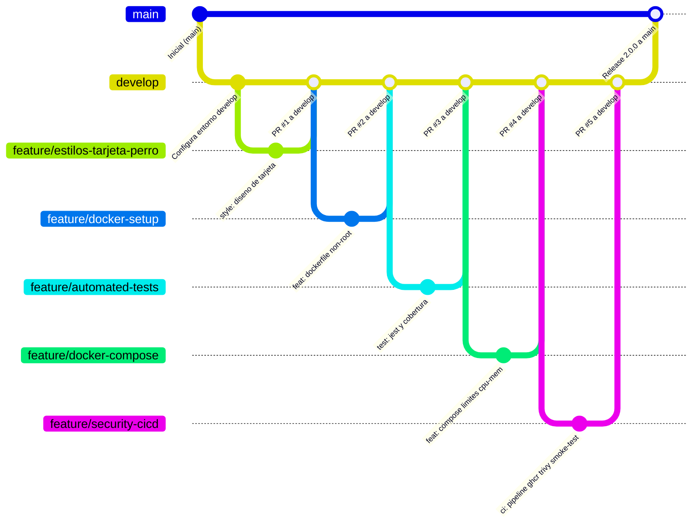
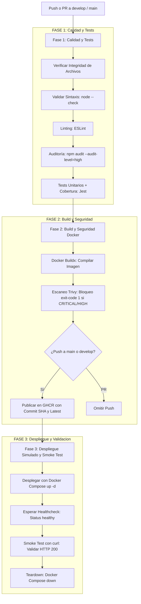

# Lista de perros 🐶 - DevOps Engineering Platform

Aplicación web interactiva que consume la API de [dog.ceo](https://dog.ceo/dog-api/) para clasificar imágenes de perros ("me gusta" / "no me gusta"), implementada con estándares de Ingeniería DevOps: control de versiones con **GitFlow**, **Conventional Commits**, pruebas automatizadas con **Jest (cobertura estricta)**, análisis estático con **ESLint**, contenedorización segura multi-stage (**Nginx Alpine non-root**), orquestación con límites de recursos (**Docker Compose**), escaneo estricto de vulnerabilidades (**Trivy**), gestión de dependencias (**Dependabot**) y entrega continua con trazabilidad inmutable (**GHCR + Commit SHA**) con despliegue simulado y **smoke test (HTTP 200)**.

---

## 🚀 Cómo levantar el proyecto localmente

### Opción 1: Mediante Contenedores con Docker Compose (Recomendada)
Para ejecutar la aplicación exactamente bajo las mismas condiciones del entorno de producción y simulación:

```bash
# Construir la imagen y levantar el contenedor en segundo plano
docker compose up -d --build

# Verificar el estado de salud del contenedor (Healthcheck)
docker compose ps

# Comprobar la respuesta HTTP del servicio (Smoke Test local)
curl -I http://localhost:8080/

# Ver logs en tiempo real
docker compose logs -f

# Detener el servicio y limpiar redes
docker compose down
```

La aplicación estará disponible inmediatamente en `http://localhost:8080/`.

### Opción 2: Desarrollo y Ejecución Local de Pruebas
```bash
# Instalar dependencias del proyecto
npm install

# Validar sintaxis nativa de JavaScript
node --check index.js

# Ejecutar linter estático (ESLint)
npm run lint

# Ejecutar suite de pruebas unitarias y verificar umbral de cobertura (Jest)
npm test
```

---

## 🌳 Estrategia de ramificación (GitFlow)

Para este proyecto se implementó la estrategia de ramificación **GitFlow**, asegurando estabilidad en producción y desacoplamiento en las etapas de desarrollo e integración.

### Justificación Técnica
1. **Separación Estricta de Entornos:**
   - `main`: Rama de **Producción**. Solo recibe código completamente probado, escaneado y validado mediante Pull Request.
   - `develop`: Rama base de **Integración Continua (Staging)**. Agrupa el trabajo consolidado de las ramas de características (`feature/*`) antes de un release.
2. **Colaboración Segura entre Desarrolladores:**
   - Cada funcionalidad se desarrolla de forma aislada en ramas dedicadas (`feature/*`) que nacen desde `develop` y se reintegran a `develop` mediante Pull Request con revisión de pares obligatoria.
3. **Gestión Ágil de Incidentes Críticos (`hotfix/*`):**
   - Ante fallos de severidad alta detectados en producción, se generan ramas de parche urgente (`hotfix/*`) que nacen de `main` y, tras resolverse, se fusionan simultáneamente a `main` y a `develop`.

### Diagrama del Flujo de Ramas



---

## 📝 Convenciones de commits (Conventional Commits v1.0.0)

El equipo aplica rigurosamente la especificación **Conventional Commits (v1.0.0)** para garantizar un historial legible, semántico y apto para pipelines automatizados.

### Formato Obligatorio
```text
<tipo>(<alcance opcional>): <descripción concisa en imperativo y minúsculas>
```

### Tipos Permitidos y Ejemplos en el Proyecto

| Tipo | Propósito | Ejemplos en el Proyecto |
| :--- | :--- | :--- |
| `feat` | Incorporación de una nueva funcionalidad visible o lógica. | `feat(docker): agrega dockerfile multi-stage y usuario non-root`<br>`feat(compose): define servicio con limites de cpu y memoria` |
| `fix` | Corrección de un fallo o error de lógica. | `fix(api): implementa bloque try-catch y banner de error de red`<br>`fix(docker): corrige mapeo de puertos en unprivileged port` |
| `test` | Implementación o ajuste de pruebas unitarias o de integración. | `test(unit): agrega pruebas jest para validacion de urls y contadores`<br>`test(coverage): valida umbral minimo del 75% en index.js` |
| `ci` | Cambios en workflows de GitHub Actions o automatizaciones de pipeline. | `ci(pipeline): integra escaneo trivy con bloqueo obligatorio y ghcr`<br>`ci(workflow): agrega prueba de humo con curl en runner simulado` |
| `style` | Modificaciones visuales, maquetación CSS o diseño (sin alterar lógica). | `style(badges): agrega badges redondeados para contadores de votos`<br>`style(card): optimiza sombras y transiciones en foto principal` |
| `docs` | Actualización o ampliación de documentación técnica. | `docs: documenta arquitectura de contenedores, trivy y trazabilidad` |
| `chore` | Mantenimiento rutinario de dependencias y configuraciones. | `chore(deps): actualiza dependencias y configura dependabot semanal` |

---

## 🔀 Convenciones de naming de ramas

1. **Ramas Protegidas:**
   - `main`: Código en producción, 100% estable, probado y auditado.
   - `develop`: Base de integración para features antes de un release.
2. **Ramas de Características (`feature/<nombre-kebab-case>`):**
   - Nacen de `develop` y se reintegran a `develop` vía PR.
   - Ejemplos: `feature/docker-setup`, `feature/automated-tests`, `feature/docker-compose`, `feature/security-cicd`.
3. **Ramas de Parche Urgente (`hotfix/<nombre-kebab-case>`):**
   - Nacen de `main` y se reintegran a `main` y `develop`.
   - Ejemplo: `hotfix/manejo-error-api`.

---

## 🔍 Estrategia de revisión (Pull Requests)

Para garantizar la estabilidad y calidad del software, **está estrictamente prohibido el push directo a `develop` y `main`**. Las integraciones se realizan mediante Pull Request cumpliendo con:

1. **Revisión de Pares Obligatoria (Peer Review):** Todo PR requiere aprobación del revisor técnico antes de autorizar la fusión (*Merge*).
2. **Quality Gates en CI en Verde:**
   - Validación léxica y de sintaxis con `node --check`.
   - Linter estático sin advertencias críticas con ESLint (`no-undef`).
   - Auditoría de seguridad de dependencias (`npm audit --audit-level=high`).
   - 100% de pruebas unitarias Jest aprobadas cumpliendo el umbral de cobertura (`coverageThreshold` >= 75%).
   - Escaneo de contenedor con Trivy sin vulnerabilidades críticas ni altas (`exit-code: 1`).
   - Prueba de humo (Smoke Test) exitosa con HTTP 200 en el runner.
3. **Higiene del Repositorio:** Una vez fusionado el PR, la rama de trabajo secundaria se elimina en GitHub para evitar acumulación de ramas huérfanas.

---

## 🐳 Arquitectura de Contenedores y Orquestación (IE1, IE5)

### Dockerfile Multi-Stage y Principio de Menor Privilegio
El empaquetado de la aplicación se definió en [Dockerfile](file:///Dockerfile) bajo una arquitectura **multi-stage**:
- **Stage 1 (Builder - `node:20-alpine`):** Ejecuta la validación sintáctica de JavaScript mediante el motor V8 (`node --check index.js`) antes del empaquetado final, impidiendo que código corrupto pase a la imagen de distribución.
- **Stage 2 (Producción - `nginx:alpine`):** Imagen base ultraligera basada en Alpine Linux (~23 MB).
- **Usuario Sin Privilegios (Non-Root):** Se configura explícitamente `USER nginx` (UID 101). Nginx se reconfigura para escuchar en el puerto no privilegiado `8080`, redirigiendo el archivo PID a `/tmp/nginx.pid` y asignando propiedad de los directorios de trabajo a `nginx:nginx`. Esto previene ataques de escalamiento de privilegios y garantiza el cumplimiento de las guías CIS Docker Benchmark.
- **Healthcheck Nativo:** Se incluye la directiva `HEALTHCHECK` que ejecuta periódicamente `wget -q -O /dev/null http://localhost:8080/ || exit 1` para reportar el estado de salud al daemon de Docker.
- **Contexto Optimizado (`.dockerignore`):** Excluye `.git`, `.github`, `node_modules`, `tests`, `coverage` y archivos temporales, reduciendo drásticamente el tamaño del contexto de build.

### Orquestación con Docker Compose
En [docker-compose.yml](file:///docker-compose.yml) se define la orquestación del servicio con parámetros de seguridad y alta disponibilidad:
- **Mapeo de Puertos:** Redirecciona `8080:8080` hacia el puerto unprivileged del contenedor.
- **Aislamiento de Red:** Red dedicada tipo bridge (`app-network`).
- **Política de Reinicio:** `restart: unless-stopped`.
- **Límites Estrictos de Recursos:**
  - `limits.cpus: "0.50"` (máximo 50% de 1 CPU).
  - `limits.memory: 128M` (límite duro de 128 Megabytes de RAM).
  - `reservations.cpus: "0.10"`, `reservations.memory: 64M`.
  Esto evita ataques de denegación de servicio (DoS) por agotamiento de recursos del host.
- **Healthcheck Sincronizado:** Permite al orquestador evaluar la disponibilidad del servicio con intervalos de 15 segundos y reintentos automáticos.

---

## 🧪 Pruebas Automatizadas y Quality Gates (IE2)

El proyecto cuenta con una batería de pruebas automatizadas ejecutadas mediante **Jest** y el entorno simulado de DOM **jest-environment-jsdom**:

1. **Validación Léxica:** `node --check index.js` previene errores sintácticos antes de cualquier fase.
2. **Análisis Estático (Linting):** ESLint analiza la coherencia del código en navegadores y Node.js, bloqueando variables no definidas (`no-undef`).
3. **Pruebas Unitarias ([tests/app.test.js](file:///tests/app.test.js)):**
   - **Módulo 1:** Validación de URLs e imágenes permitidas (expresiones regulares, protocolos HTTP/S, extensiones válidas vs. no soportadas o nulas).
   - **Módulo 2:** Lógica matemática de incremento y actualización de estado inmutable para contadores de interacción.
   - **Módulo 3:** Captura y modelado de errores de red (respuestas HTTP 500, excepciones de red simuladas con mocks de `fetch`, formato inválido).
   - **Módulo 4:** Manipulación interactiva del DOM (inserción de imágenes en contenedores de like/dislike, actualización de badges numéricos, activación/desactivación de loaders y manejo de errores visuales).
4. **Umbral de Cobertura Obligatorio (`coverageThreshold`):**
   Configurado en [package.json](file:///package.json):
   ```json
   "coverageThreshold": {
     "global": {
       "branches": 75,
       "functions": 75,
       "lines": 75,
       "statements": 75
     }
   }
   ```
   Si la cobertura de ramas, funciones, líneas o sentencias cae por debajo del 75%, Jest finaliza con código de salida 1, **bloqueando automáticamente el pipeline de CI/CD**.

---

## 🛡️ Parámetros de Seguridad y Escalabilidad (IE3)

1. **Principio de Menor Privilegio en CI/CD:**
   El workflow de GitHub Actions restringe explícitamente los permisos otorgados al token automático `GITHUB_TOKEN`:
   ```yaml
   permissions:
     contents: read
     packages: write
   ```
   Se bloquea cualquier acceso innecesario a issues, pull requests o administración del repositorio.
2. **Gestión Automatizada de Vulnerabilidades con Dependabot ([.github/dependabot.yml](file:///.github/dependabot.yml)):**
   - Escaneo periódico semanal (lunes a las 04:00 AM) para dependencias de **npm**.
   - Escaneo periódico semanal para acciones de **github-actions**.
   - Asignación automática de etiquetas `dependencies` y `security`.
   - Generación de Pull Requests automáticos con prefijos convencionales (`chore(deps)` y `ci(deps)`).
3. **Auditoría de Vulnerabilidades en Dependencias:**
   Ejecución de `npm audit --audit-level=high` durante la fase de CI, bloqueando el avance si se identifican vulnerabilidades conocidas en las bibliotecas de Node.js.
4. **Escaneo Estricto de Seguridad en Contenedores con Trivy:**
   Integración de la acción oficial `aquasecurity/trivy-action`:
   ```yaml
   - name: Escaneo Estricto de Seguridad con Trivy (Bloqueo Obligatorio)
     uses: aquasecurity/trivy-action@master
     with:
       image-ref: ${{ steps.image-tag.outputs.image }}:${{ github.sha }}
       format: 'table'
       exit-code: '1'
       ignore-unfixed: true
       vuln-type: 'os,library'
       severity: 'CRITICAL,HIGH'
   ```
   **Criterio de Bloqueo Exigido:** Si Trivy detecta una vulnerabilidad con severidad `CRITICAL` o `HIGH` en el sistema operativo base o librerías empaquetadas, el comando retorna `exit-code: 1`. Esto interrumpe de inmediato el pipeline, impidiendo la publicación de la imagen en el registro y cancelando el despliegue.

---

## 🚀 Despliegue, Trazabilidad y Smoke Tests (IE4)

### Pipeline Integral CI/CD ([.github/workflows/ci-cd.yml](file:///.github/workflows/ci-cd.yml))



### Trazabilidad Inmutable con GHCR y Commit SHA
- La imagen construida se etiqueta y publica en **GitHub Container Registry (`ghcr.io`)** utilizando el hash criptográfico del commit:
  `ghcr.io/<organizacion-o-usuario>/<repositorio>:${{ github.sha }}`
- Esto garantiza **inmutabilidad de artefactos**, reproducibilidad exacta de cualquier versión desplegada y auditoría completa de extremo a extremo (desde el código fuente en Git hasta el contenedor en ejecución).

### Despliegue en Entorno Simulado y Smoke Test
Antes de certificar una entrega, el pipeline ejecuta un despliegue automático simulado en el runner de GitHub Actions:
1. Levanta el contenedor en segundo plano con `docker compose up -d --build`.
2. Monitorea activamente el `healthcheck` del contenedor en un bucle de sondeo hasta confirmar el estado `healthy`.
3. Ejecuta una **Prueba de Humo (Smoke Test)** enviando una petición HTTP real mediante `curl`:
   ```bash
   HTTP_STATUS=$(curl -s -o /dev/null -w "%{http_code}" http://localhost:8080/)
   ```
4. Valida que el código de respuesta sea estrictamente **HTTP 200 OK**. Si el servicio responde con cualquier código distinto o no está disponible, el pipeline falla de forma controlada y expone los logs del contenedor para facilitar el diagnóstico.
5. Ejecuta la limpieza de infraestructura (*teardown*) mediante `docker compose down -v`.

---

## 📁 Estructura del proyecto

```text
evaluacion-devops-002D/
├── .github/
│   ├── dependabot.yml          # Escaneo periódico semanal (npm y github-actions)
│   └── workflows/
│       └── ci-cd.yml           # Pipeline completo de CI/CD (Quality Gates, Trivy, GHCR, Smoke Test)
├── tests/
│   └── app.test.js             # Suite de pruebas unitarias Jest con entorno JSDOM
├── .dockerignore               # Filtros de exclusión para contexto de build en Docker
├── .gitignore                  # Reglas de exclusión para el control de versiones en Git
├── Dockerfile                  # Multi-stage build con Nginx Alpine, usuario non-root y healthcheck
├── docker-compose.yml          # Orquestación con límites de CPU/RAM, red bridge y healthcheck
├── index.html                  # Estructura semántica, panel de contadores y contenedor de error
├── index.js                    # Lógica modular para consumo de API, contadores y eventos del DOM
├── package.json                # Configuración de dependencias, scripts de test/lint y coverageThreshold
├── package-lock.json           # Árbol reproducible de dependencias fijadas
├── style.css                   # Reglas visuales, estilos de tarjetas, badges y loaders
└── README.md                   # Documentación integral de ingeniería y gobernanza DevOps
```

---

## 👥 Autores y Gobernanza DevOps

- **Integrante 1:** Gaspar Toro
- **Integrante 2:** Alvaro Pérez

---

### Reflexión Individual - Gaspar Toro
El desarrollo de esta fase consolidó la importancia del enfoque *Shift-Left Security* y la automatización rigurosa dentro del ciclo de vida del software. Implementar un contenedor con usuario sin privilegios (`non-root`) y someterlo a un escaneo estricto con Trivy con código de salida bloqueante evidenció cómo las políticas de seguridad dejan de ser un paso manual al final del desarrollo para convertirse en puertas de calidad (*Quality Gates*) automáticas. La trazabilidad lograda mediante el etiquetado por commit SHA en GHCR y el despliegue simulado con smoke test garantizan que cada artefacto liberado sea inmutable, seguro y completamente reproducible.

---

### Reflexión Individual - Alvaro Pérez
La integración de pruebas unitarias con Jest bajo un umbral de cobertura estricto (`coverageThreshold`) representó un salto de calidad fundamental respecto a etapas anteriores. Ya no solo validamos la sintaxis del código, sino que garantizamos la integridad funcional de la lógica de negocio y el manejo resiliente de errores ante caídas de la API. Asimismo, la orquestación con Docker Compose delimitando recursos de CPU y memoria demostró cómo la infraestructura como código previene riesgos operativos de sobreconsumo en entornos productivos.
