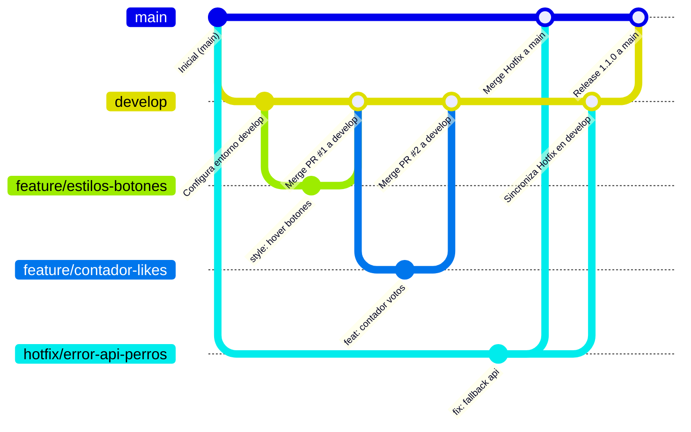

# Lista de perros 🐶

La idea de este proyecto es dar un pequeño repaso sobre conexiones a una API y sobre eventos. Es una pequeña aplicación web que muestra imágenes de perros aleatorias (obtenidas desde [dog.ceo](https://dog.ceo/dog-api/)) y permite marcarlas como "me gusta" o "no me gusta".

Este repositorio es la **base de trabajo** para la Evaluación Parcial N°1 de Ingeniería DevOps (DOY0101). A partir de este punto, el equipo construye su propio flujo de trabajo colaborativo aplicando Git, GitHub y GitHub Actions bajo estándares profesionales de la industria.

---

## 🚀 Cómo levantar el proyecto localmente

No requiere instalación previa de dependencias complejas. Basta con abrir `index.html` en el navegador, o servirlo con cualquier servidor estático simple, por ejemplo:

```bash
npx serve .
```

O utilizando extensiones de servidor local como *Live Server* en VS Code.

---

## 🌳 Estrategia de ramificación

Para este proyecto se implementó la estrategia de ramificación **GitFlow**.

### Justificación Técnica
Aunque "Lista de perros" es una aplicación web estática y ligera (HTML5, CSS3 y Vanilla JavaScript), la adopción de GitFlow se fundamenta en los siguientes principios de ingeniería DevOps:

1. **Simulación de Entornos Profesionales:** Permite modelar de manera estricta la separación entre el código en **Producción** (`main`), que debe ser 100% estable y operable en todo momento, y el entorno de **Integración/Staging** (`develop`), donde convergen los desarrollos antes de ser liberados.
2. **Colaboración Segura entre 2 Integrantes:** Evita conflictos de concurrencia al desarrollar características en paralelo. Cada integrante aísla su trabajo en ramas dedicadas (`feature/*`) que nacen desde `develop`, impidiendo que código incompleto o inestable impacte la rama principal.
3. **Gestión Ágil de Incidentes Críticos (`hotfix/*`):** Si surge un fallo de alta severidad en producción (por ejemplo, interrupción o caída de la API de dog.ceo o falla en los botones de interacción), el flujo permite desplegar un parche urgente directamente desde `main`. Este parche se integra de inmediato a `main` y simultáneamente se propaga a `develop`, sin arrastrar cambios no probados que aún estén en desarrollo.

### Diagrama del Flujo de Ramas



---

## 📝 Convenciones de commits

El equipo adopta el estándar internacional **Conventional Commits (v1.0.0)**. Esta convención garantiza un historial de Git legible, semántico y preparado para pipelines automatizados de versionamiento y generación de changelogs.

### Formato Obligatorio
```text
<tipo>(<alcance opcional>): <descripción en imperativo y minúsculas>
```

### Tipos Permitidos y Ejemplos Aplicados al Proyecto

| Tipo | Propósito | Ejemplos en el Proyecto "Lista de Perros" |
| :--- | :--- | :--- |
| `feat` | Incorporación de una nueva funcionalidad visible o lógica para el usuario. | `feat: agrega contador de me gusta`<br>`feat(api): añade manejo de estados de carga con spinner` |
| `fix` | Corrección de un error o anomalía en el funcionamiento. | `fix: corrige error al cargar imagen del perro`<br>`fix(events): reasigna listener de click en boton de saltear` |
| `style` | Ajustes cosméticos, tipografías, maquetación CSS o espaciado (sin cambios en lógica). | `style: centra botones de votación`<br>`style(cards): agrega sombras y bordes redondeados a fotos de perros` |
| `docs` | Cambios exclusivos en archivos de documentación. | `docs: actualiza estrategia de ramas y guia colaborativa en README` |
| `refactor` | Reestructuración de código que no altera el comportamiento ni arregla bugs. | `refactor(api): modulariza funcion nuevoPerro con async/await limpio` |
| `ci` | Modificaciones en workflows de integración continua o scripts de CI/CD. | `ci: agrega workflow de validacion de sintaxis y linter con github actions` |
| `chore` | Tareas rutinarias de mantenimiento o configuración general del repositorio. | `chore: actualiza archivo .gitignore para omitir archivos temporales` |

---

## 🔀 Convenciones de naming de ramas

Se establece una nomenclatura estricta en minúsculas (*kebab-case*) utilizando prefijos semánticos según el rol de la rama:

### 1. Ramas Principales (Protegidas)
- `main`: Rama de producción. Contiene únicamente código estable, auditado y listo para el usuario final.
- `develop`: Rama base de integración continua. Agrupa el trabajo consolidado de las distintas características antes de un release.

### 2. Ramas de Características (`feature/<nombre-descriptivo>`)
- Nacen obligatoriamente desde `develop` y se reintegran exclusivamente a `develop` mediante Pull Request.
- **Ejemplos orientados al proyecto:**
  - `feature/estilos-botones`: Implementación de estilos visuales modernos y micro-animaciones a los botones de votar.
  - `feature/contador-likes`: Incorporación del contador numérico para registrar "me gusta" y "no me gusta".
  - `feature/filtro-razas`: Selección de razas específicas consumiendo endpoints secundarios de dog.ceo.

### 3. Ramas de Corrección Urgente (`hotfix/<nombre-descriptivo>`)
- Nacen directamente desde `main` ante fallos críticos en producción y se fusionan mediante Pull Request tanto a `main` como a `develop`.
- **Ejemplos orientados al proyecto:**
  - `hotfix/error-api-perros`: Corrección ante cambios de respuesta, timeouts o caída del servicio de dog.ceo.
  - `hotfix/fallback-imagen-caida`: Inclusión de una imagen placeholder si la URL de la foto retorna 404.
  - `hotfix/evento-botones-bloqueados`: Solución a bloqueo de botones durante transiciones rápidas de imágenes.

---

## 🔍 Estrategia de revisión (Pull Requests)

Para garantizar la calidad del código y mantener la estabilidad de los entornos, **ningún cambio puede ser subido directamente a `develop` ni a `main`**. Todas las integraciones deben pasar por un proceso formal de Pull Request (PR) que cumpla con los siguientes criterios:

1. **Revisión de Pares Obligatoria (Peer Review):** Todo PR debe ser revisado y aprobado por el otro integrante del equipo antes de autorizar la fusión (*Merge*). No se permite la auto-aprobación.
2. **Integridad Funcional del DOM y Eventos:**
   - La funcionalidad principal de JavaScript no debe verse afectada: los botones de interacción (`like`, `dislike`, `saltear`) deben responder adecuadamente.
   - El consumo de la API de dog.ceo debe mantenerse asíncrono y gestionar correctamente la promesa del `fetch`.
   - La interfaz debe preservar la respuesta visual (ocultar/mostrar spinner y contenedores de imágenes).
3. **Validación Automática de CI (Status Checks en verde):**
   - El workflow de GitHub Actions (`ci.yml`) debe ejecutarse y finalizar con éxito (código de salida 0).
   - No deben existir errores de sintaxis, variables sin definir ni fallas detectadas por el linter.
4. **Higiene del Repositorio:**
   - Una vez aprobado y fusionado el PR, la rama secundaria de trabajo (`feature/*` o `hotfix/*`) debe eliminarse de inmediato en GitHub para evitar acumulación de ramas huérfanas.

---

## ⚙️ Automatización (CI/CD)

Se implementó un pipeline automatizado de Integración Continua utilizando **GitHub Actions**, ubicado en `.github/workflows/ci.yml`.

### Disparadores (Triggers)
- **`push` en la rama `develop`:** Valida de forma inmediata cada integración o fusión que ingresa al entorno de pruebas.
- **`pull_request` con destino a `main` y `develop`:** Actúa como *puerta de calidad* (Quality Gate), bloqueando la incorporación de código defectuoso antes de que sea fusionado.

### Acciones que Ejecuta el Workflow
1. **Entorno de Ejecución:** Se ejecuta sobre contenedores con la última versión estable de Ubuntu (`ubuntu-latest`).
2. **Checkout del Código:** Descarga la versión exacta del repositorio correspondiente al commit o evento.
3. **Configuración de Runtime:** Inicializa un entorno controlado de Node.js v20.
4. **Verificación de Integridad de Archivos:** Comprueba que los archivos fundamentales de la aplicación web (`index.html`, `style.css`, `index.js`) se encuentren presentes en la raíz.
5. **Validación de Sintaxis JavaScript (Motor V8):** Ejecuta `node --check index.js` para detectar de forma instantánea cualquier error sintáctico, llaves sin cerrar o instrucciones incompatibles.
6. **Análisis Estático de Código (Linter):** Ejecuta ESLint configurado específicamente para el entorno navegador (`browser`) y ECMAScript moderno, verificando que no existan variables no definidas (`no-undef`) ni errores lógicos críticos.

### Rol en un Entorno DevOps Real
En la industria, este pipeline representa la **primera línea de defensa (Shift-Left Testing)**. Automatizar la verificación estática previene que errores sintácticos o inconsistencias lleguen a producción, reduce los tiempos de retroalimentación para los desarrolladores y asegura que el revisor humano en el Pull Request se concentre en la arquitectura y valor del negocio, en lugar de revisar detalles mecánicos de sintaxis.

---

## 📁 Estructura de carpetas

```
Lista-de-perros-eva-ea1/
├── .github/
│   └── workflows/
│       └── ci.yml          # Workflow de integración continua (GitHub Actions)
├── index.html              # Estructura semántica de la aplicación
├── index.js                # Lógica de consumo de API de dog.ceo y eventos del DOM
├── style.css               # Reglas de estilo y presentación visual
├── .gitignore              # Configuración de exclusión de archivos temporales
└── README.md               # Documentación integral del proyecto y gobernanza DevOps
```

---

## 👥 Autores

- **Integrante 1:** [Gaspar Toro]
- **Integrante 2:** [Alvaro Pérez]

*Proyecto original: repaso de conexión a API y manejo de eventos en JavaScript. Adaptado como base para la Evaluación Parcial N°1, DOY0101 — Ingeniería DevOps.*

---

## Conclusiones y Reflexiones Individuales


### Reflexión Individual - Integrante 1: [Gaspar Toro]
Aprendi a utilizar de mejor forma tanto las ramas como para recordar cosas tales como el uso correcto de el control de versiones en github. Ademas de entender de mejor forma el concepto de gitflow y la manera en que se trabaja de manera colaborativa.
---

### Reflexión Individual - Integrante 2: [Alvaro Pérez]
*(Espacio reservado para la redacción manuscrita / personal del estudiante 2. Describir aprendizajes, dificultades superadas y conclusiones técnicas personales).*
