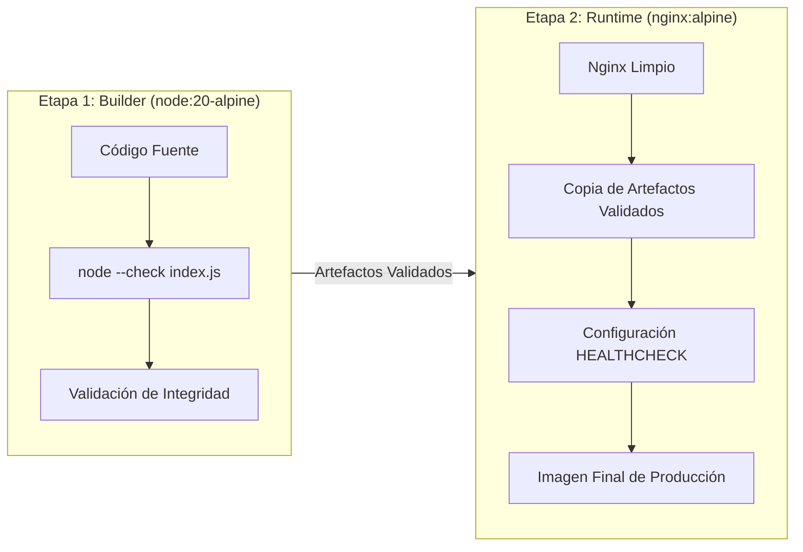
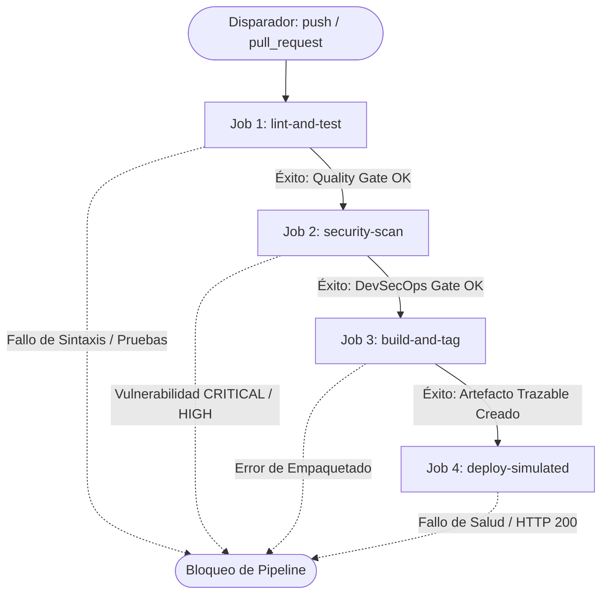
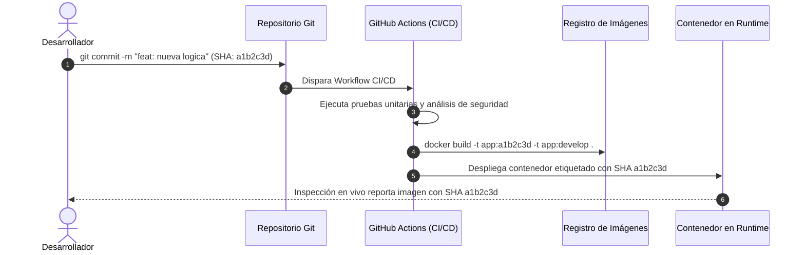

# Microservicio Dog Rating — Arquitectura de Contenedores y Plataforma CI/CD

Microservicio web para calificación interactiva y consumo asíncrono de recursos externos ([Dog CEO REST API](https://dog.ceo/dog-api/)), empaquetado bajo arquitectura de contenedores inmutables y gestionado mediante un pipeline integral de Integración y Entrega Continua (CI/CD) con gobernanza DevSecOps automatizada.

---

## 1. Descripción General y Arquitectura de Contenedores

La aplicación está diseñada como un microservicio desacoplado para entrega de contenido estático de alto rendimiento (HTML5, CSS3 y JavaScript ES6+), optimizado para ejecutarse en entornos aislados y reproducibles.

### 1.1. Estrategia Multi-Stage Build en Docker

El empaquetamiento se define en el [Dockerfile](file:///c:/Users/zente/OneDrive/Escritorio/Devops/evaluacion-devops-002D/Dockerfile) utilizando compilación en múltiples etapas (*multi-stage build*), minimizando la superficie de ataque y el tamaño final de la imagen:



- **Etapa 1 (`builder` - `node:20-alpine`):** Actúa como entorno de control de calidad previo al empaquetado, ejecutando la validación léxica y de sintaxis del código con el motor V8 (`node --check index.js`).
- **Etapa 2 (`production` - `nginx:alpine`):** Imagen minimalista de Nginx basada en Alpine Linux (~40 MB). Descarta dependencias de desarrollo y aloja exclusivamente los recursos estáticos validados en `/usr/share/nginx/html/`.
- **Healthcheck Integrado:** Define la instrucción `HEALTHCHECK` nativa para comprobar la operatividad del servidor web localmente mediante `wget -q -O /dev/null http://localhost/ || exit 1`.

### 1.2. Orquestación con Docker Compose

El archivo [docker-compose.yml](file:///c:/Users/zente/OneDrive/Escritorio/Devops/evaluacion-devops-002D/docker-compose.yml) estandariza el aprovisionamiento local y de pruebas:

- **Aislamiento de Red:** Define una red tipo puente dedicada (`app-network`) con controlador `bridge`.
- **Mapeo de Puertos:** Expone el puerto `80` del contenedor hacia el puerto `8080` del host (`8080:80`).
- **Límites de Recursos:** Restringe el consumo máximo a `0.50` CPUs y `128M` de memoria RAM, garantizando contención de recursos.
- **Monitoreo de Salud:** Configura sondeo periódico (`interval: 15s`, `timeout: 5s`, `retries: 3`, `start_period: 5s`).

---

## 2. Ciclo de Vida CI/CD (GitHub Actions)

El ciclo de vida está automatizado en [.github/workflows/ci-cd.yml](file:///c:/Users/zente/OneDrive/Escritorio/Devops/evaluacion-devops-002D/.github/workflows/ci-cd.yml). El flujo se dispara ante eventos de `push` y `pull_request` dirigidos a las ramas protegidas `main` y `develop`.

### 2.1. Topología del Pipeline y Puertas de Calidad

La ejecución está organizada en cuatro fases secuenciales conectadas mediante dependencias estrictas (`needs`):



### 2.2. Detalle de los Jobs

1. **`lint-and-test`:**
   - Inicializa el entorno con `actions/setup-node@v4` en Node.js v20.
   - Ejecuta verificación de integridad de archivos (`index.html`, `style.css`, `index.js`).
   - Valida la sintaxis del motor JavaScript con `node --check index.js`.
   - Ejecuta análisis estático con ESLint en entorno Browser (`no-undef: error`).
   - Instala dependencias deterministas mediante `npm ci`.
   - Ejecuta la suite de pruebas unitarias con Jest (`npm test`), validando expresiones regulares de URLs, inmutabilidad de contadores y resiliencia ante caídas de red.

2. **`security-scan` (Depende de `lint-and-test`):**
   - Ejecuta análisis de composición de software (SCA) y del sistema de archivos con Trivy (`aquasecurity/trivy-action@0.28.0`).
   - Aplica política de tolerancia cero ante severidades `CRITICAL` y `HIGH` mediante `exit-code: '1'`.

3. **`build-and-tag` (Depende de `security-scan`):**
   - Construye la imagen Docker del microservicio.
   - Aplica doble etiquetado inmutable: por Commit SHA (`${{ github.sha }}`) y por rama de procedencia (`${{ env.BRANCH_TAG }}`).

4. **`deploy-simulated` (Depende de `build-and-tag`):**
   - Inicializa el contenedor en el entorno del runner ejecutando `docker compose up -d --build`.
   - Realiza sondeo activo con `docker inspect --format='{{json .State.Health.Status}}'` hasta verificar el estado `"healthy"`.
   - Valida la disponibilidad HTTP 200 consumiendo el endpoint con `curl -f http://localhost:8080/`.
   - Garantiza la limpieza ordenada del entorno mediante `docker compose down` al finalizar.

---

## 3. Mecanismo de Trazabilidad Técnica

Para asegurar auditoría total desde el código fuente hasta el artefacto en ejecución, se implementa una estrategia de vinculación criptográfica basada en el **Commit SHA (`${{ github.sha }}`)**:



### Beneficios Técnicos:
- **Identificación Unívoca:** Cada imagen compilada (`dog-rating-app:${{ github.sha }}`) corresponde exactamente a un estado inmutable del árbol de Git.
- **Rollback Instantáneo y Determinista:** Ante incidentes en producción, es posible revertir la versión en ejecución directamente al hash del commit anterior sin necesidad de recompilar código fuente.
- **Auditoría de Cumplimiento:** Permite demostrar que el contenedor desplegado superó con éxito las pruebas unitarias y el análisis de vulnerabilidades del commit específico.

---

## 4. Gobernanza y Seguridad DevSecOps

El repositorio adopta el enfoque **Shift-Left Security**, detectando y mitigando riesgos en las etapas más tempranas del ciclo de desarrollo.

### 4.1. Análisis Automatizado de Dependencias con Dependabot

El archivo [.github/dependabot.yml](file:///c:/Users/zente/OneDrive/Escritorio/Devops/evaluacion-devops-002D/.github/dependabot.yml) gestiona la obsolescencia y los parches de seguridad:
- **Ecosistemas Auditados:** `npm` (dependencias de aplicación) y `github-actions` (versiones de acciones del pipeline).
- **Frecuencia:** Escaneo semanal programado los lunes a las 08:00 UTC.
- **Gobernanza de Pull Requests:** Genera PRs automáticos clasificados con etiquetas estándar (`security`, `dependencies`) y prefijos de Conventional Commits (`chore(deps)`, `chore(ci)`).

### 4.2. Hard Gate con Trivy Vulnerability Scanner

La integración de `aquasecurity/trivy-action` en el pipeline actúa como una compuerta estricta (*Hard Gate*):
- **Parámetro `severity: 'CRITICAL,HIGH'`:** Filtra vulnerabilidades de impacto crítico y alto (CVEs con puntuación CVSS elevada).
- **Parámetro `exit-code: '1'`:** Interrumpe de inmediato el workflow si se detecta cualquier vulnerabilidad que coincida con los criterios definidos, impidiendo la construcción de artefactos o despliegues comprometidos.

---

## 5. Guía de Despliegue Local

### Prerrequisitos
- Docker Engine 24.0+ y Docker Compose v2.0+ instalados.
- Git instalado.
- Puerto `8080` disponible en la máquina anfitriona.

### Paso 1: Clonar el Repositorio
```bash
git clone https://github.com/Shiroasd/evaluacion-devops-002D.git
cd evaluacion-devops-002D
```

### Paso 2: Construir e Iniciar los Servicios
Ejecuta la orquestación en segundo plano forzando la compilación del Dockerfile:
```bash
docker compose up -d --build
```

### Paso 3: Verificar el Estado de Salud del Contenedor
Comprueba que el contenedor haya superado el período de inicio y se encuentre en estado `healthy`:
```bash
docker inspect --format='{{json .State.Health.Status}}' dog-app-container
```
*Salida esperada:* `"healthy"`

Para listar los contenedores activos y puertos expuestos:
```bash
docker compose ps
```

### Paso 4: Validar la Disponibilidad HTTP
Comprueba la respuesta HTTP 200 mediante cURL o abre tu navegador en `http://localhost:8080`:
```bash
curl -I http://localhost:8080/
```
*Respuesta esperada:* `HTTP/1.1 200 OK`

### Paso 5: Detener el Servicio y Limpiar Recursos
Para detener y remover los contenedores y redes asociadas:
```bash
docker compose down
```

---

## 6. Estándares de Trabajo Colaborativo

### 6.1. Estrategia de Ramificación (GitFlow)
- `main`: Rama de producción. Solo recibe cambios auditados mediante Pull Request.
- `develop`: Rama de integración continua. Base de consolidación previa a releases.
- `feature/*`: Ramas de características desarrolladas en paralelo.
- `hotfix/*`: Parches correctivos urgentes derivados directamente desde `main`.

### 6.2. Convenciones de Commits (Conventional Commits v1.0.0)
Formato obligatorio: `<tipo>(<alcance opcional>): <descripción>`
- `feat`: Nueva funcionalidad.
- `fix`: Corrección de errores.
- `style`: Modificaciones visuales o cosméticas.
- `ci`: Cambios en flujos de integración continua.
- `chore`: Tareas de mantenimiento o configuración de dependencias.

---

## 7. Conclusiones y Reflexiones Técnicas

> [!IMPORTANT]
> **Recordatorio de Autoría:** Las siguientes reflexiones deben ser redactadas de forma manual y personal por cada desarrollador del equipo, describiendo sus aprendizajes técnicos, retos resueltos y aportes al ciclo de vida DevOps.

### Reflexión Técnica — Integrante 1: [Gaspar Toro]
```text
[Espacio reservado para redacción manual del Desarrollador 1: Describir aprendizajes en Docker multi-stage, configuración de Hard Gates en Trivy, resolución de dependencias con Dependabot y gestión de ramas bajo GitFlow.]
```

---

### Reflexión Técnica — Integrante 2: [Alvaro Pérez]
```text
[Espacio reservado para redacción manual del Desarrollador 2: Describir aprendizajes en orquestación con Docker Compose, verificación de salud con healthchecks, trazabilidad mediante Commit SHA y validación de endpoints HTTP.]
```
